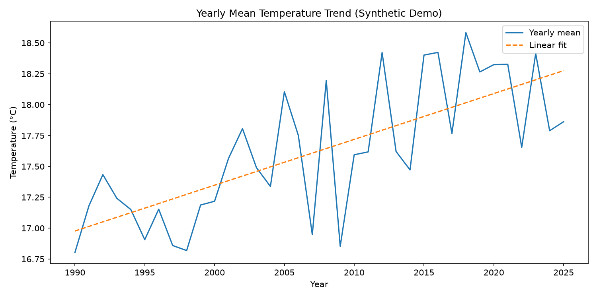
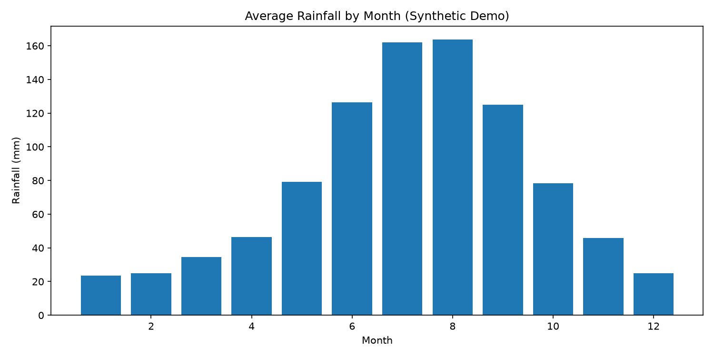

# Climate Trend Analyzer 🌦️

A beginner-friendly Python data science project that explores temperature, rainfall, seasonal patterns, and statistical anomaly candidates. It includes a reproducible data pipeline, charts, CSV outputs, automated tests, and an optional Streamlit dashboard.

> **Data integrity note:** The default pipeline generates synthetic demonstration data. It is not an official climate dataset and must not be used as evidence of real regional or global climate change. To make real-world claims, replace it with a documented public dataset and preserve its source, units, geographic coverage, and licensing information.

## Problem statement
Climate datasets can be difficult to interpret without cleaning, aggregation, trend summaries, and visual communication. This project demonstrates a transparent workflow for converting monthly observations into useful exploratory summaries.

## Features
- Synthetic monthly climate data generator with a seasonal cycle, illustrative warming signal, and injected demonstration anomalies
- Data validation, date parsing, duplicate removal, range checks, and missing-value handling
- Yearly temperature/rainfall/humidity summaries
- Linear descriptive trend fit for yearly mean temperature
- Isolation Forest anomaly candidates
- PNG charts and CSV outputs
- Streamlit dashboard
- Basic automated tests

## Technology stack
Python, Pandas, NumPy, Matplotlib, scikit-learn, Streamlit, pytest, and Linear Regression.

## Architecture
```text
Synthetic or public CSV
        |
        v
Data loading + validation
        |
        v
Cleaning + date features
        |
        +------> Yearly aggregation ------> Linear descriptive trend
        |
        +------> Isolation Forest -------> Anomaly candidates
        |
        v
CSV summaries + PNG charts + text insights
        |
        v
Optional Streamlit dashboard
```

## Folder structure
```text
Climate-Trend-Analyzer/
├── app/streamlit_app.py
├── data/raw/                 # input CSV (generated locally)
├── data/processed/           # cleaned CSV
├── notebooks/                # optional notebooks
├── outputs/                  # tables, summaries, and images
├── src/
│   ├── config.py
│   ├── data_generator.py
│   ├── preprocessing.py
│   ├── analysis.py
│   └── visualize.py
├── tests/test_pipeline.py
├── main.py
├── requirements.txt
└── README.md
```

## Setup

### Windows PowerShell
```powershell
py -3.11 -m venv .venv
.\.venv\Scripts\Activate.ps1
python -m pip install --upgrade pip
pip install -r requirements.txt
```
If `py -3.11` is unavailable, install Python 3.11 or use `python -m venv .venv` with a compatible Python installation.

### macOS/Linux
```bash
python3 -m venv .venv
source .venv/bin/activate
python -m pip install --upgrade pip
pip install -r requirements.txt
```

## Run the full pipeline
From the repository root:
```bash
python main.py
```

Expected outputs:
- `data/raw/climate_observations.csv`
- `data/processed/climate_cleaned.csv`
- `outputs/yearly_summary.csv`
- `outputs/anomalies.csv`
- `outputs/insights.txt`
- `outputs/images/temperature_trend.png`
- `outputs/images/monthly_rainfall.png`
- `outputs/images/temperature_vs_rainfall.png`

Exact anomaly counts can vary by library version and dataset. The run should finish with a reminder that the data are synthetic.

## Launch the dashboard
After running `python main.py`:
```bash
streamlit run app/streamlit_app.py
```

## Run tests
```bash
python -m pytest -q
```

## Methods and limitations
- **Yearly aggregation:** averages monthly temperature and humidity and sums monthly rainfall.
- **Linear regression:** describes the straight-line relationship between year and yearly mean temperature. It does not model the full climate system.
- **Isolation Forest:** flags unusual multivariate observations relative to the dataset. A flag is not proof of a real-world extreme event.
- **Synthetic data:** designed for reproducible software demonstration, not climatological inference.
- **Missing values:** numeric gaps are interpolated and then filled with the median if needed. For a scientific dataset, justify cleaning choices based on source documentation.

## Screenshots
After running the pipeline and dashboard, add genuine screenshots under `outputs/images/` or `docs/screenshots/`, then embed them here, for example:
```markdown


```
Do not use mock screenshots as proof of a successful run; capture your own application output.

## Future improvements
- Replace synthetic values with a cited public dataset (for example, NOAA, NASA, or national meteorological open data)
- Add region/city filters and dataset metadata
- Compare trend estimators and report uncertainty
- Add time-aware validation before forecasting
- Add seasonal decomposition and extreme-event metrics
- Add map-based visualization and automated report export

## Learning outcomes
Data cleaning, time-series feature engineering, descriptive statistics, anomaly detection, visualization, testing, dashboarding, Git workflows, and responsible communication of model limitations.

## Author
Student portfolio project — update this section with your name, profile, and repository URL before publishing.
